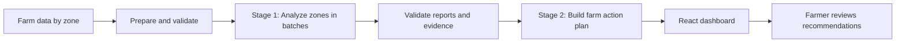
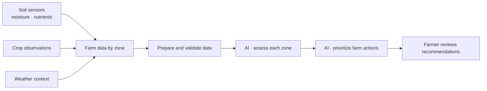
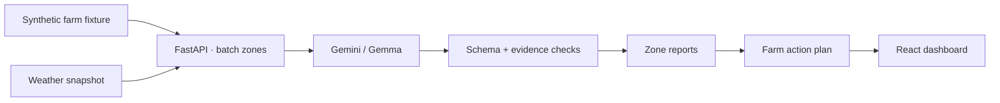

# AgroMind AI 🌱
### Smarter farm decisions, zone by zone.

AgroMind AI helps farmers identify **which farm zones need attention first** by turning soil, crop, and weather data into clear, evidence-based recommendations for hydration and fertilization.

> **Our goal:** help farmers make better-informed decisions, use resources more wisely, and spend less time reviewing scattered data.

## 🚜 The problem

Farm data can be scattered across soil sensors, crop observations, and weather reports. Comparing every reading manually makes it difficult to spot problems and prioritize the next action.

## 💡 Our solution

AgroMind AI analyzes farm zones, checks the evidence, and creates a prioritized farm action plan.

1. **Collect** — combine zone measurements, crop observations, and weather context.
2. **Analyze** — use AI to assess each zone in manageable batches.
3. **Validate** — check AI outputs against shared data schemas and source evidence.
4. **Prioritize** — summarize zone assessments into a farm-wide action plan.
5. **Review** — explore results and recommendations in an interactive dashboard.

## ✨ What the demo includes

- Zone-level hydration and fertilization insights
- Evidence-linked AI assessments and prioritized recommendations
- A farm-wide action plan generated from zone reports
- Weather context and a dashboard for exploring results
- Structured output validation and separation of evaluation labels from AI inputs

## 🎬 Project Demo

Experience AgroSupervisor AI in action! Watch our cinematic demo to see how our platform combines farm-zone monitoring, weather intelligence, and AI-powered agricultural recommendations.

  <video src="assets/agrosupervisor-demo.mp4" controls width="100%">
    Your browser does not support embedded videos.
  </video>

  <strong>🌱 Smarter Farming. Better Decisions.</strong>

## 🧠 How it works

### What this hackathon demo uses

The two-stage approach keeps zone-level analysis separate from farm-wide prioritization. This helps make recommendations easier to trace and review.

## 🛠️ Tech stack

- **Frontend:** React
- **Backend:** FastAPI
- **AI:** Gemini / Gemma
- **Data:** Structured JSON contracts, synthetic farm data, and a weather snapshot

## ⚠️ Demo limitations

- The included farm measurements are **synthetic**; they are not live sensor readings.
- The demo uses an included weather snapshot rather than a fully live farm deployment.
- AI processing can be slow or fail on large requests. The current approach uses smaller batches; future work includes caching, controlled retries, and better progress reporting.
- Recommendations are for decision support only. A person must review them before acting. The system does **not** directly control pumps, valves, or fertilizer equipment.

## 🚀 What's next?

- Cache unchanged data and previous validated results to reduce repeated AI calls.
- Add background processing, retries, and clearer analysis progress and data-freshness indicators.
- Build an AI chat assistant for farm questions and on-demand reports.
- Store historical data to compare zone conditions over time.
- Explore safe equipment integration with simulation, strict limits, and human approval before any real-world action.

## 📂 Project structure

| Folder | Purpose |
|---|---|
| `front-end/` | React dashboard |
| `back-end/` | FastAPI, data preparation, weather adapter |
| `ai/` | AI prompts, analysis, and validation |
| `data-set/` | Synthetic farm fixture and evaluation labels |
| `contracts/` | Shared schemas and example inputs |

## 🌾 The vision

From scattered farm signals to clear priorities — and, in the future, safer precision-agriculture operations.

## 👥 The Team: We are

  
  <h1 align="center">👥 RootSignal</h1>
  
<i>Every signal matters. Every drop counts.</i>

<h2 align="center">👥 Meet the Team</h2>

| Member | Responsibilities |
|:---|:---|
| **Yassine El Azime** | 📊 Dataset & Weather Data Generation · 🚀 Web App Deployment |
| **Abdellah Ait Mouhi** | ⚙️ Backend Development · 🧠 AI Pipeline |
| **Oumaima Naanaa** | ⚙️ Backend Development · 🧠 AI Pipeline |
| **Safouane Ajdi** | 🎨 Frontend Development · 🖌️ UI/UX Design |

  <i>Built with collaboration, powered by AI, designed for smarter agriculture. 🌱</i>

