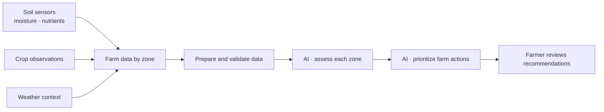
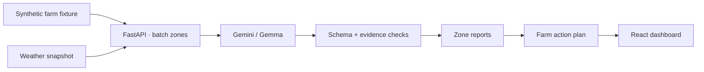

# AgroMind AI

**From field signals to clearer farm decisions.** AgroMind is the decision-support software layer of a larger precision-agriculture project. It helps a farmer spot hydration and fertilization concerns by zone and decide what to check next.

## The problem

Farm decisions depend on signals spread across soil sensors, crop observations, and weather. Reviewing each reading by hand makes it hard to see which zones need attention, especially when data is incomplete or conflicting.

## How AI helps

AI turns those mixed observations into a first-pass assessment for each zone, then summarizes the validated assessments into a prioritized plan. It can connect patterns across many records faster than manual review; without it, a person would need to inspect and compare each zone and signal one by one. The model must cite the input evidence, can report insufficient evidence, and cannot operate farm equipment. A person reviews every recommendation.

## The solution

The broader project gathers measurements from sensors placed across farm zones, alongside crop observations and local weather. This repository implements the **software part**: it accepts structured sensor records, analyzes them, and presents evidence-linked recommendations in a dashboard. It does not include sensor hardware or automatically control irrigation or fertilizer systems.

### What this hackathon demo uses

Farm sensor readings in this demo are **synthetic**, not live hardware telemetry. The API serves the included weather snapshot. The analysis uses two AI stages: per-zone assessments, followed by a farm-wide plan. Shared JSON contracts validate outputs, and evidence IDs connect recommendations back to source records. Evaluation labels are kept separate from AI inputs.

## Try AgroMind

**Live demo:** _Vercel link coming soon._

## Project map

| Area | Responsibility |
| --- | --- |
| `front-end/` | React dashboard |
| `back-end/` | FastAPI, data preparation, weather adapter |
| `ai/` | Gemini/Gemma prompts, analysis, and validation |
| `data-set/` | Synthetic farm fixture and offline evaluation labels |
| `contracts/` | Shared data schemas and example inputs |

This is a decision-support prototype. Recommendations are informational and require human review.
